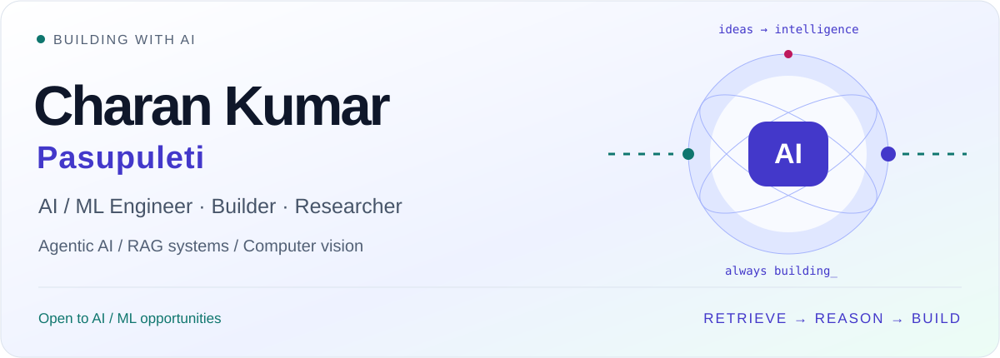
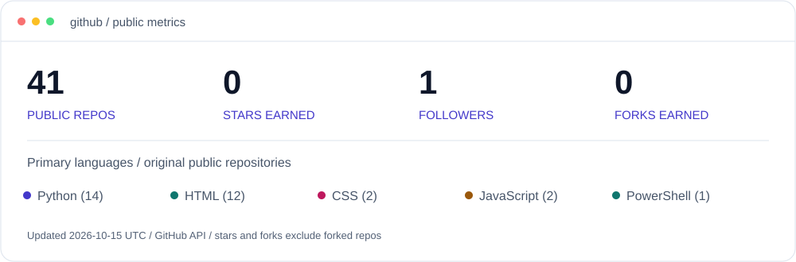
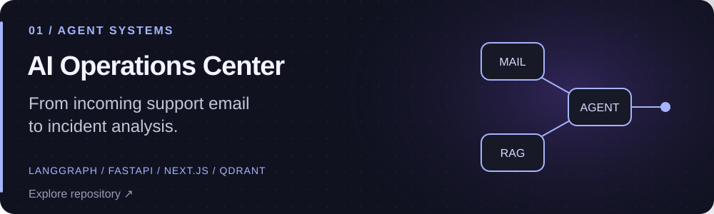
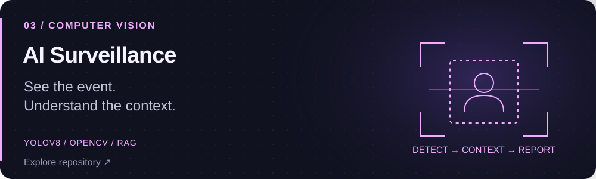
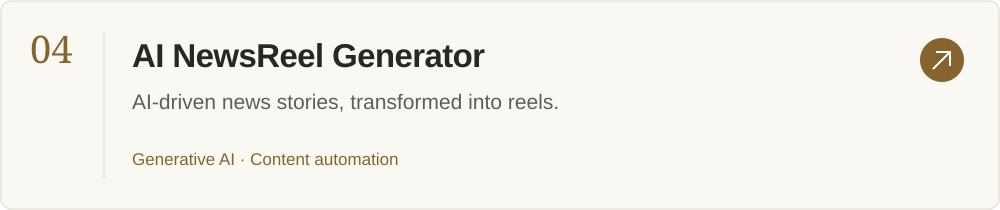
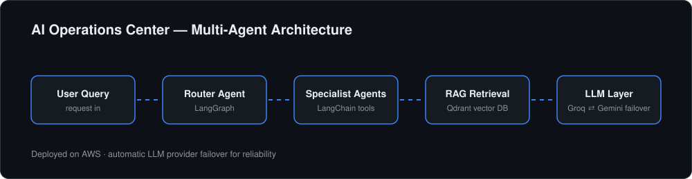
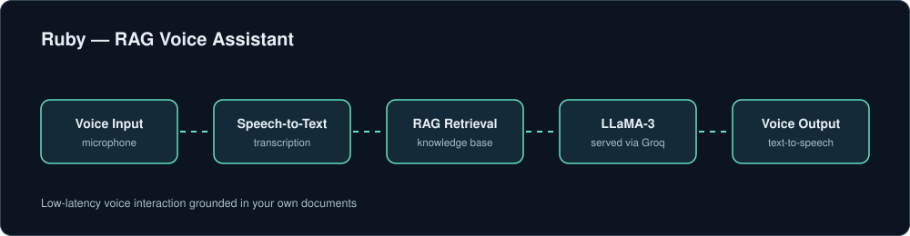
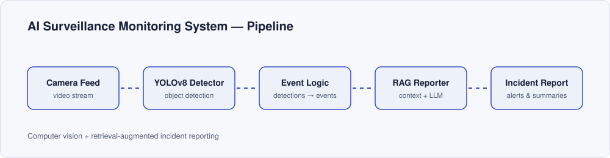

<div align="center">



[](https://www.linkedin.com/in/pasupuleticharankumar1611)
[](mailto:pasupuleticharankumar16@gmail.com)
[](https://github.com/PasupuletiC?tab=repositories)

[About](#-about) · [Projects](#-projects) · [Stack](#-stack) · [Activity](#-activity)

</div>

## ~/ about

I build **AI applications that retrieve, reason, and act** — from incident-handling agents to voice assistants and vision pipelines.

```yaml
current:   AI Developer Intern @ Brollysolutions
education: B.Tech CSE · Kalasalingam · 2026
research:  IEEE INDICON 2025 · Energy prediction
learning:  LLM evaluation, agent reliability, deployment
looking:   AI/ML Engineer & AI Developer opportunities
```

## ~/ dashboard



## ~/ projects

<a href="https://github.com/PasupuletiC/AI-Operations-Center"></a>

**Inside:** Email routing, root-cause analysis, knowledge retrieval, and model routing across Groq, Gemini, and Ollama.

<a href="https://github.com/PasupuletiC/rag-voice-assistant"></a>

**Inside:** Persistent memory, document retrieval, OCR, web search, and English, Hindi, Tamil, and Telugu voice modes.

<a href="https://github.com/PasupuletiC/AI_Surveillance_Monitoring_System"></a>

**Focus:** Connecting visual detections with context for incident reporting.

<a href="https://github.com/PasupuletiC/AI-NewsReel-Generator"></a>

<details>
<summary><strong>Under the hood / architecture diagrams</strong></summary>
<br />



</details>

## ~/ stack

<p align="center">

</p>

<p align="center">


</p>

## ~/ research

**IEEE INDICON 2025 — Energy prediction**

Random Forest modeling for energy prediction, alongside my ongoing interest in applied machine learning and model evaluation.

## ~/ activity

<picture>
<source media="(prefers-color-scheme: dark)" srcset="https://raw.githubusercontent.com/PasupuletiC/PasupuletiC/output/snake-dark.svg" />

</picture>

---

<div align="center">

**Have an AI problem worth building for?**

[Let's connect on LinkedIn](https://www.linkedin.com/in/pasupuleticharankumar1611) · [Send me an email](mailto:pasupuleticharankumar16@gmail.com)

<sub>Building, learning, and shipping — one commit at a time.</sub>

</div>
