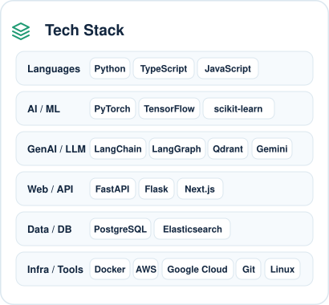
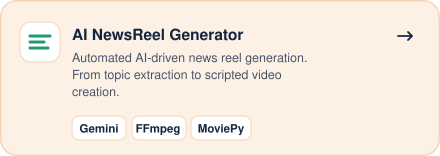
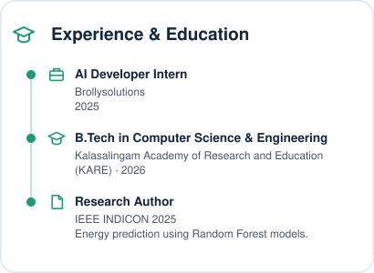
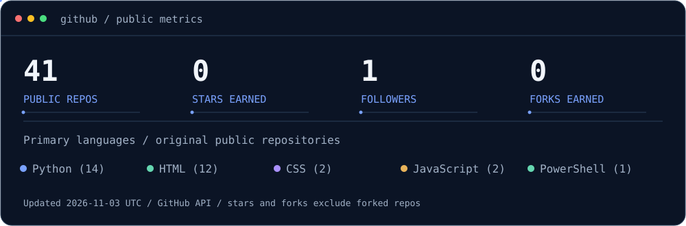

  

  
  
  

  

<table width="100%">
<tr>
<td width="48%" valign="top">

 

</td>
<td width="52%" valign="top">

 

 

 

 

</td>
</tr>
<tr>
<td width="48%" valign="top">

</td>
<td width="52%" valign="top">

</td>
</tr>
</table>

**More projects:** [DataFlow Automator](https://github.com/PasupuletiC/dataflow-automator) (automated data cleaning, quality analysis and reporting) · [AI Interview Platform](https://github.com/PasupuletiC/AI-Interview-Platform) · [AI Candidate Screening](https://github.com/PasupuletiC/ai-candidate-screening-system) · [Live Transcription](https://github.com/PasupuletiC/Live-Transcription)

<strong>Implementation notes</strong>: a closer look at the projects

- **[AI Operations Center](https://github.com/PasupuletiC/AI-Operations-Center):** Processes incoming support emails, routes agent tasks, retrieves previous resolutions with Qdrant, and generates root-cause analysis. Supports Groq, Gemini, and local Ollama model routing, with a Next.js dashboard and FastAPI backend.
- **[Ruby Voice Assistant](https://github.com/PasupuletiC/rag-voice-assistant):** Combines persistent memory, document retrieval, OCR, web search, and voice interaction. Includes English, Hindi, Tamil, and Telugu voice modes.
- **[AI Surveillance](https://github.com/PasupuletiC/AI_Surveillance_Monitoring_System):** Connects YOLOv8 detections and OpenCV processing with retrieval-augmented incident reporting.
- **[AI NewsReel Generator](https://github.com/PasupuletiC/AI-NewsReel-Generator):** Automates AI-driven news reel generation.

## GitHub activity

<picture>
  <source media="(prefers-color-scheme: dark)" srcset="./assets/activity-dark.svg" />
  <source media="(prefers-color-scheme: light)" srcset="./assets/activity-light.svg" />
  
</picture>

<picture>
  <source media="(prefers-color-scheme: dark)" srcset="https://raw.githubusercontent.com/PasupuletiC/PasupuletiC/output/snake-dark.svg" />
  
</picture>

  

  
  
  

