## About me

I build AI applications that **retrieve knowledge, coordinate agents, and interpret visual data**. My focus is practical: reliable model behavior, affordable infrastructure, and clear user experiences.

- AI Developer Intern at **Brollysolutions**
- B.Tech in Computer Science & Engineering, **KARE** (2026)
- **IEEE INDICON 2025** author: energy prediction with Random Forest models
- Currently going deeper on LLM evaluation and production deployment

## Tech stack

 

**GenAI / LLM:** LangChain · LangGraph · Qdrant · FAISS · Groq · Gemini · LLaMA-3 · YOLOv8

## Featured projects

<table>
<tr>
<td width="50%" align="center">

</td>
<td width="50%" align="center">

</td>
</tr>
<tr>
<td width="50%" align="center">

</td>
<td width="50%" align="center">

</td>
</tr>
<tr>
<td width="50%" align="center">

</td>
<td width="50%" align="center">

</td>
</tr>
</table>

## Highlights

- Internship at **NITK Surathkal** under Prof. Chandrasekaran K (RASP - AI, Project-Code 2025-P039)
- **IIT Madras Shaastra Hackathon**: Top 50 Team (Jan 2025)
- **Kalasalingam ACM Hackathon**: Finalist (Dec 2025)
- **Pathway GenAI Hackathon**, IIT Hyderabad: Top 10 Team
- Geospatial project: LULC classification and change detection (Idukki, 2021–2025) using Sentinel-2 and Random Forest

## GitHub stats

<picture>
  <source media="(prefers-color-scheme: dark)" srcset="https://raw.githubusercontent.com/PasupuletiC/PasupuletiC/output/snake-dark.svg" />
  
</picture>

## Let's connect

Open to entry-level **AI/ML Engineer** and **AI Developer** roles. Happy to talk about RAG, agents and computer vision.

