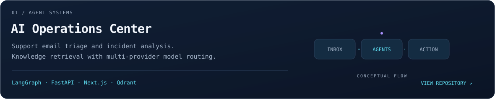
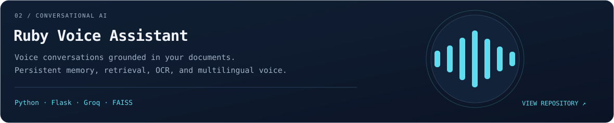
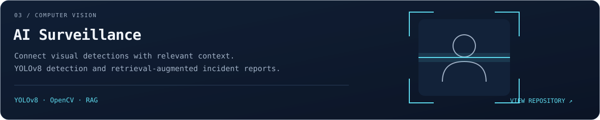
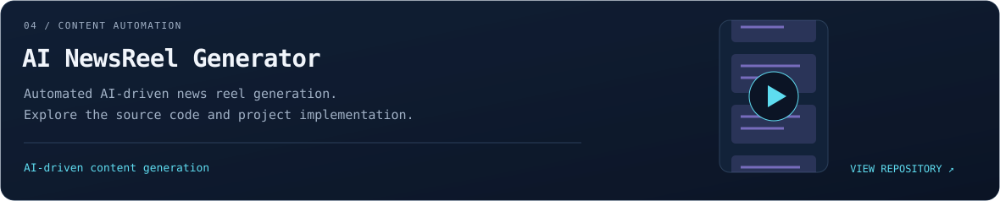
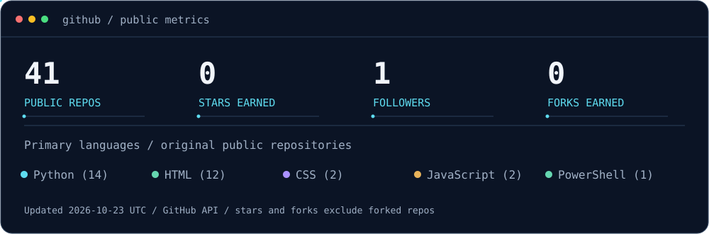

<picture>
  <source media="(prefers-color-scheme: dark)" srcset="./dark.svg" />
  <source media="(prefers-color-scheme: light)" srcset="./light.svg" />
  
</picture>

  <a href="#selected-work">Selected work</a> &nbsp;·&nbsp;
  <a href="#engineering-stack">Engineering stack</a> &nbsp;·&nbsp;
  <a href="#background">Background</a> &nbsp;·&nbsp;
  <a href="#github-activity">Activity</a> &nbsp;·&nbsp;
  <a href="#connect">Connect</a>

I build **AI applications that retrieve knowledge, coordinate agents, and interpret visual data**. My focus is practical: reliable model behavior, affordable infrastructure, and clear interfaces.

## Selected work

<a href="https://github.com/PasupuletiC/AI-Operations-Center">
<picture>
  <source media="(prefers-color-scheme: dark) and (max-width: 600px)" srcset="./assets/work-operations-dark-mobile.svg" />
  <source media="(prefers-color-scheme: light) and (max-width: 600px)" srcset="./assets/work-operations-light-mobile.svg" />
  <source media="(prefers-color-scheme: dark)" srcset="./assets/work-operations-dark.svg" />
  <source media="(prefers-color-scheme: light)" srcset="./assets/work-operations-light.svg" />
  
</picture>
</a>

<a href="https://github.com/PasupuletiC/rag-voice-assistant">
<picture>
  <source media="(prefers-color-scheme: dark) and (max-width: 600px)" srcset="./assets/work-ruby-dark-mobile.svg" />
  <source media="(prefers-color-scheme: light) and (max-width: 600px)" srcset="./assets/work-ruby-light-mobile.svg" />
  <source media="(prefers-color-scheme: dark)" srcset="./assets/work-ruby-dark.svg" />
  <source media="(prefers-color-scheme: light)" srcset="./assets/work-ruby-light.svg" />
  
</picture>
</a>

<a href="https://github.com/PasupuletiC/AI_Surveillance_Monitoring_System">
<picture>
  <source media="(prefers-color-scheme: dark) and (max-width: 600px)" srcset="./assets/work-vision-dark-mobile.svg" />
  <source media="(prefers-color-scheme: light) and (max-width: 600px)" srcset="./assets/work-vision-light-mobile.svg" />
  <source media="(prefers-color-scheme: dark)" srcset="./assets/work-vision-dark.svg" />
  <source media="(prefers-color-scheme: light)" srcset="./assets/work-vision-light.svg" />
  
</picture>
</a>

<a href="https://github.com/PasupuletiC/AI-NewsReel-Generator">
<picture>
  <source media="(prefers-color-scheme: dark) and (max-width: 600px)" srcset="./assets/work-news-dark-mobile.svg" />
  <source media="(prefers-color-scheme: light) and (max-width: 600px)" srcset="./assets/work-news-light-mobile.svg" />
  <source media="(prefers-color-scheme: dark)" srcset="./assets/work-news-dark.svg" />
  <source media="(prefers-color-scheme: light)" srcset="./assets/work-news-light.svg" />
  
</picture>
</a>

<strong>Implementation notes</strong> — a closer look at the projects

- **[AI Operations Center](https://github.com/PasupuletiC/AI-Operations-Center):** Processes incoming support emails, routes agent tasks, retrieves previous resolutions with Qdrant, and generates root-cause analysis. Supports Groq, Gemini, and local Ollama model routing, with a Next.js dashboard and FastAPI backend.
- **[Ruby Voice Assistant](https://github.com/PasupuletiC/rag-voice-assistant):** Combines persistent memory, document retrieval, OCR, web search, and voice interaction. Includes English, Hindi, Tamil, and Telugu voice modes.
- **[AI Surveillance](https://github.com/PasupuletiC/AI_Surveillance_Monitoring_System):** Connects YOLOv8 detections and OpenCV processing with retrieval-augmented incident reporting.
- **[AI NewsReel Generator](https://github.com/PasupuletiC/AI-NewsReel-Generator):** Automates AI-driven news reel generation.

## Engineering stack

| Area | Technologies |
| :--- | :--- |
| **AI & retrieval** | LangGraph · LangChain · Qdrant · FAISS · Groq · Gemini |
| **Machine learning & vision** | Python · PyTorch · TensorFlow · YOLOv8 · OpenCV |
| **Application development** | FastAPI · Flask · React · Next.js · PostgreSQL |
| **Infrastructure & tools** | Docker · AWS · Google Cloud · Git · Linux |

**Current learning:** LLM evaluation, agent reliability, and production deployment.

## Background

- **Experience:** AI Developer Intern at **Brollysolutions**.
- **Education:** B.Tech in Computer Science, **Kalasalingam Academy of Research and Education**, 2026.
- **Research:** **IEEE INDICON 2025** author; energy prediction using Random Forest models.

## GitHub activity

<picture>
  <source media="(prefers-color-scheme: dark)" srcset="./assets/activity-dark.svg" />
  <source media="(prefers-color-scheme: light)" srcset="./assets/activity-light.svg" />
  
</picture>

Contribution animation

<picture>
  <source media="(prefers-color-scheme: dark)" srcset="https://raw.githubusercontent.com/PasupuletiC/PasupuletiC/output/snake-dark.svg" />
  
</picture>

## Connect

Open to entry-level **AI/ML Engineer** and **AI Developer** opportunities, and conversations about RAG, agents, and computer vision.

**[LinkedIn ↗](https://www.linkedin.com/in/pasupuleticharankumar1611)** &nbsp;·&nbsp; **[Email ↗](mailto:pasupuleticharankumar16@gmail.com)** &nbsp;·&nbsp; **[All repositories ↗](https://github.com/PasupuletiC?tab=repositories)**
